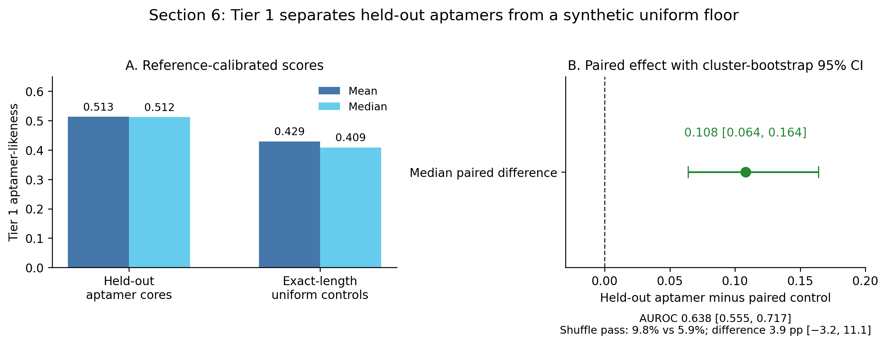
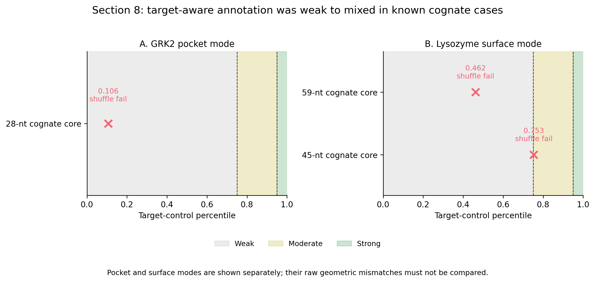
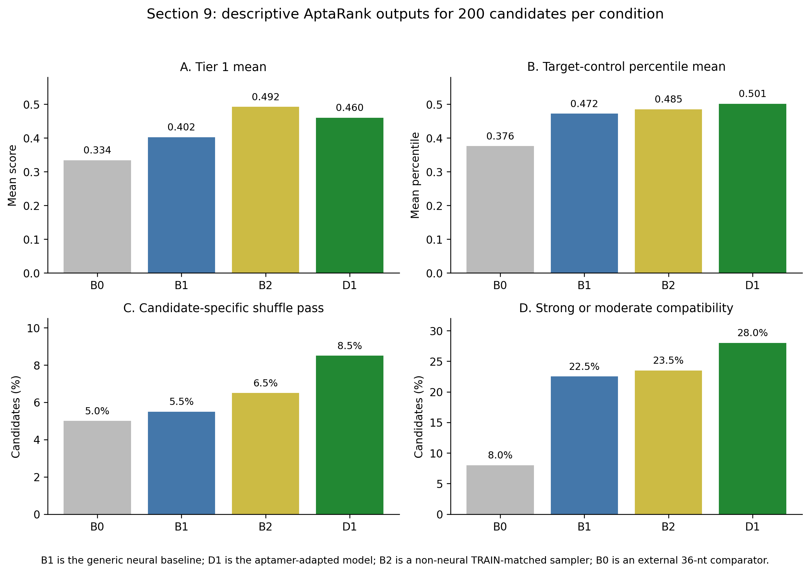
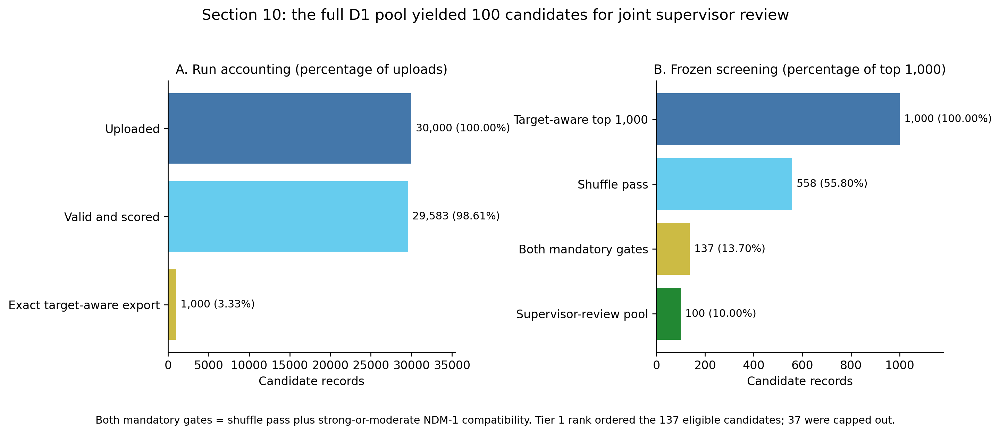

# Supervisor briefing: AptaRank evaluation and NDM-1 candidate prioritisation

**Status: computational evaluation complete and final future-shortlisting outcome adopted — 30 October 2026.**

Following supervisor consultation, no MRes candidate will be progressed to experimental validation. The final sequence-bearing output is the **50 highest Tier 1 ranked D1 candidates**, retained as candidates progressing towards shortlisting for experimental validation after future work improves the computational prioritisation and evaluation approach.

- Active decision plan: `docs/evaluation/aptarank_full_mres_thesis_evaluation_plan_v3_10.md`, SHA-256 `08b019ce00ea87485dee1c1d436eca3d1b9780d3506ad8c88716cf089f53c020`.
- Detailed quantitative material: [AptaRank supervisor tables and figures](aptarank_evaluation_supervisor_tables.md).
- Closed Section 10 result: [Section 10 closure record](../../results/aptarank/evaluation/section10_d1_full_pool_ndm1_evaluation_preset_v1/closure/section10_computational_pool_closure_record.json).

## Executive summary

AptaRank was evaluated in four linked stages before being used to prepare an NDM-1 candidate-review pool.

First, its target-independent Tier 1 score showed a **moderate, statistically supported ability to distinguish held-out aptamer sequences from paired uniform-RNA controls**. Across 153 evaluable pairs, the median aptamer-minus-control difference was 0.108, with a cluster-bootstrap 95% confidence interval of 0.064 to 0.164. The corresponding AUROC was 0.638. This is useful evidence that Tier 1 contains an aptamer-likeness signal, although it is far from perfect classification.

The candidate-specific shuffle check was less convincing. It passed for 15/153 held-out aptamers (9.8%) and 9/153 uniform controls (5.9%); the 3.9-percentage-point difference had a 95% confidence interval from −3.2 to 11.1 percentage points. The check is therefore conservative and has low sensitivity in this evaluation.

Second, the target-aware Tier 2 annotation was tested on three known cognate aptamer cores spanning pocket and surface binding modes. The GRK2 core was weak at target-control percentile 0.106. The two lysozyme cores were weak at 0.462 and only marginally moderate at 0.753. None was strong, and all three failed their candidate-specific shuffle checks. This small panel therefore supplied **weak-to-mixed evidence for the target-aware annotation**, not confirmation that it reliably recognises known binders.

Third, 200 candidates from each of four generation conditions were compared in one NDM-1 run. The aptamer-adapted model, D1, outperformed the matched generic neural baseline, B1, on mean Tier 1 score (0.460 versus 0.402), shuffle-pass rate (8.5% versus 5.5%), mean NDM-1 target-control percentile (0.501 versus 0.472), and strong-or-moderate compatibility rate (28.0% versus 22.5%). However, the simple non-neural B2 sampler had a higher mean Tier 1 score than D1 (0.492 versus 0.460) and a very similar mean target-control percentile (0.485 versus 0.501). The D1 advantage over B1 is therefore modest and does not show that fine-tuning produced uniquely target-ready sequences.

Finally, the complete 30,000-sequence D1 pool was run once against NDM-1. AptaRank scored 29,583 sequences and recorded 417 length exclusions. The original, prospectively frozen rule produced 137 candidates passing both computational gates and a closed 100-candidate review pool. After the complete evidence was considered with the biology supervisor, that historical pool was not used to advance candidates to laboratory work. A later, explicitly outcome-aware amendment instead retained Tier 1 ranks 1–50 as a reproducible future-work hand-off; shuffle and Tier 2 are carried forward only as coarse annotations.

The central conclusion is:

> AptaRank Tier 1 provided a moderate aptamer-likeness signal and a transparent way to rank a large generated pool. The target-aware layer supplied only weak-to-mixed validation evidence and is further limited by the selected NDM-1 cavity geometry. No sequence was progressed to experimental validation. The 50 highest Tier 1 ranked D1 candidates are retained only as candidates progressing towards future shortlisting, not as predicted binders or experimentally selected NDM-1 aptamers.

## What was evaluated

| Stage | Scientific question | Design | Closed outcome |
|---|---|---|---|
| Tier 1 calibration | Does the target-independent ranking distinguish held-out aptamers from a simple synthetic floor? | 154 held-out sequence cores paired with exact-length uniform RNA; one pair excluded for length, leaving 153 complete pairs across 79 sequence clusters. | Moderate separation; low and uncertain shuffle-pass sensitivity. |
| Target-aware illustration | Does the target-aware pathway give sensible annotations to known cognate examples? | One GRK2 pocket-mode core and two lysozyme surface-mode cores, assessed as separate descriptive cases. | Weak to mixed; no strong annotations and three shuffle failures. |
| Generated-condition comparison | How do four generation approaches compare on the same Tier 1 and NDM-1 outputs? | 200 score-blind candidates each from B0, B1, B2 and D1; 800 scored in one target-enabled run. | D1 modestly exceeded B1, but B2 remained competitive or better on key outputs. |
| Full D1 prioritisation | What did the frozen gate-based rule produce, and what future-work hand-off is scientifically supportable after reviewing all evidence? | One run of all 30,000 D1 sequences; historical gate-based analysis preserved, followed by a transparent outcome-aware final-disposition amendment. | Historical result: 137 eligible and 100 retained for review. Final disposition: ranks 1–50 retained for future shortlisting; none advanced to experimental validation. |

The stages answer different questions. The first two assess the prioritisation tool. The 800-candidate comparison then describes how its outputs vary across generation conditions. The final run uses the resulting evidence to screen D1 candidates for human assessment.

## How AptaRank was used

### Tier 1: target-independent aptamer-likeness

Tier 1 asks whether an RNA sequence has folding and composition features similar to a frozen reference collection of 113 curated aptamer cores. It combines five equally weighted, reference-anchored criteria:

- length-normalised minimum free energy;
- ensemble defect;
- mean positional entropy;
- stem fraction; and
- GC fraction.

Lower values are favoured for the first three uncertainty or energy measures. Stem fraction and GC fraction are favoured when they lie near the reference median rather than at either extreme. The resulting score lies between 0 and 1 and orders the candidates. It is an empirical ranking score, not a probability of being an aptamer.

### Candidate-specific shuffled-control check

Each candidate is also compared with 99 deterministic dinucleotide-preserving shuffles of itself. This asks whether its structural score depends on nucleotide order rather than composition alone. A `pass` means that the candidate reached the frozen Monte Carlo threshold of p ≤ 0.05. This check is deliberately conservative and is reported separately from Tier 1 rank.

### Tier 2: target-aware geometric compatibility

Tier 2 asks whether a predicted RNA shape is geometrically plausible for a user-specified target site and binding mode. Pocket mode compares an ensemble-derived loop reach with a protein-cavity dimension. Surface mode compares an estimated RNA footprint with a configured protein surface patch.

The raw geometric mismatch is positioned within a fixed 5,085-member bank of REF-derived shuffled controls scored against the same target. The resulting target-control percentile is labelled:

- `weak` below 0.75;
- `moderate` from 0.75 to below 0.95; or
- `strong` at or above 0.95.

Tier 2 is deliberately an annotation rather than part of the Tier 1 ranking. It does not model molecular docking, binding free energy, induced fit, affinity, specificity or inhibition.

### Frozen production settings

All final thesis runs used AptaRank 0.1.0 under the named **Evaluation** preset, with seed 42, 99 candidate shuffles and 200 sampled structures. The same 113-core reference upload calibrated each run. Target-enabled runs used the same prepared NDM-1 configuration: PDB 5ZGX, chain A, pocket/groove mode, residues 120, 122, 124, 189, 208 and 250.

Uploads were blinded with opaque identifiers. Downloaded results were joined back by those identifiers, not by row position. Raw exports were preserved unchanged, technical exclusions were recorded rather than replenished, and every closed result passed an independent recomputation and review.

## Results

### 1. Tier 1 detected a moderate aptamer-likeness signal

The final target-free Evaluation-preset run scored 306 of 308 uploaded sequences. Both excluded rows belonged to the same 121-nt aptamer/control pair, leaving 153 complete pairs. Every one of the 79 pre-rejection sequence clusters remained represented.

Held-out aptamer cores had mean/median Tier 1 scores of 0.513/0.512, compared with 0.429/0.409 for their exact-length uniform controls. The paired median difference was 0.108, with a cluster-bootstrap 95% confidence interval of 0.064 to 0.164. Descriptive AUROC was 0.638, with a 95% interval of 0.555 to 0.717. A secondary paired Wilcoxon test gave p = 0.000164702.

**Figure 1. Tier 1 calibration against a paired synthetic floor.** The score separates held-out aptamer cores from uniform RNA on average, but the overlap implied by AUROC 0.638 remains substantial. Uniform RNA is not an experimental non-binder set, so this does not establish universal aptamer classification.

The shuffled-control check passed for only 9.8% of aptamer cores and 5.9% of controls. Its between-group confidence interval included no difference. Tier 1 therefore provides the stronger observed signal; the shuffle token is retained as a conservative sequence-specific gate rather than treated as a sensitive classifier.

### 2. Known target cases exposed major Tier 2 limitations

The illustrative target panel contained two deliberately separate binding modes.

For GRK2 pocket recognition, the single 28-nt cognate core received target-control percentile 0.106 (`weak`) and failed its shuffle check. For lysozyme surface recognition, the 59-nt core received 0.462 (`weak`) and the 45-nt core received 0.753 (`moderate`), only 0.003 above the moderate threshold; both failed their shuffle checks.

**Figure 2. Exact target-control percentiles for the three cognate cores.** Pocket and surface cases are shown in separate panels and are not treated as a numerical cross-target comparison. Red crosses indicate that every candidate-specific shuffle check failed.

These outcomes do not contradict the underlying experimental binding evidence. AptaRank used sequence-predicted RNA folds and isolated protein-chain geometry rather than reproducing the crystallographic complexes or conformational adaptation during binding. The result instead shows that favourable Tier 2 annotations have limited demonstrated sensitivity in this deployment.

The configured lysozyme surface residues also overlapped no detected fpocket cavity, so the interface displayed the highest-scoring pocket only as a fallback cross-reference. That fallback is not evidence that the detected cavity is the biological binding site.

### 3. D1 modestly exceeded B1, while B2 remained competitive

The generated-condition experiment scored all 800 uploaded candidates, with 200 from each condition and no technical exclusions.

| Condition | Plain-language role | Tier 1 mean | Shuffle pass | Mean NDM-1 percentile | Strong or moderate |
|---|---|---:|---:|---:|---:|
| B0 | External released aptamer-model comparator; fixed 36-nt regime | 0.334 | 5.0% | 0.376 | 8.0% |
| B1 | Generic neural model; primary baseline for D1 | 0.402 | 5.5% | 0.472 | 22.5% |
| B2 | Non-neural sampler matched to simple training-set properties | 0.492 | 6.5% | 0.485 | 23.5% |
| D1 | Aptamer-adapted neural model, combining two training seeds | 0.460 | 8.5% | 0.501 | 28.0% |

**Figure 3. Descriptive AptaRank outputs for the four frozen candidate samples.** Each condition contributes 200 candidates. These are sample summaries, not independent training replicates or population-level estimates.

Against the matched generic B1 model, D1 gained 0.058 in mean Tier 1 score and 0.029 in mean target-control percentile. Its shuffle-pass rate was 3.0 percentage points higher, and its strong-or-moderate rate was 5.5 points higher. The target-aware difference was carried by additional `moderate` annotations, not by more `strong` annotations: D1 had 10 strong and 46 moderate candidates, compared with 11 strong and 34 moderate for B1.

The comparison with B2 is an important limitation. B2 had the highest mean Tier 1 score, 0.492, while D1 scored 0.460. D1's mean target-control percentile was only 0.016 above B2, and both had median percentile 0.569. This mirrors the earlier generator-level finding that simple training-set-matched sampling can reproduce much of the apparent aptamer resemblance measured by the available computational descriptors.

Tier 1 and target-control percentile were essentially unrelated at candidate level: Spearman rho was −0.0719 across the 800-candidate comparison. The weak numerical association reinforces the decision to report and use the two outputs separately.

### 4. The full D1 run produced a historical review pool and a later Tier-1-led future hand-off

All 30,000 frozen D1 sequences were uploaded once. AptaRank scored 29,583 and recorded 417 technical length exclusions: 11 shorter than 20 nt and 406 longer than 100 nt. Nothing was silently dropped, replaced or replenished.

The tool supplied exact target-aware values for the Tier 1 top 1,000. Within these 1,000 candidates:

- 558 passed their candidate-specific shuffle check;
- 69 were `strong`, 167 `moderate` and 764 `weak` for NDM-1;
- 236 therefore met the pooled strong-or-moderate compatibility gate; and
- 137 passed both the shuffle and compatibility gates.

The 137 jointly eligible candidates were ordered by Tier 1 rank, with opaque identifier used only for an exact Tier 1 tie. The first 100 entered the supervisor-review pool and 37 were capped out. Compatibility remained visible but did not determine the order. The retained pool contains 33 strong and 67 moderate candidates, with 58 from D1 training seed 43 and 42 from seed 44.

This gate-based ordering rule was frozen before any Section 10 candidate score was observed, but after the Section 8 and provisional Section 9 evidence had shown stronger support for Tier 1 discrimination than for a biologically meaningful distinction between `strong` and `moderate`. Its timing is therefore transparently outcome-aware with respect to the earlier tool evaluation, while remaining prospective with respect to the full-pool candidate outcomes.

**Figure 4. Section 10 accounting and deterministic screening.** The top-1,000 export is the scope of exact target-aware annotation, not a biological pass. Both mandatory gates reduced it to 137 candidates; the prespecified cap retained 100 for review.

Among the exact top 1,000, Tier 1 and target-control percentile again showed no meaningful monotonic relationship: Spearman rho was 0.00786. Together with the cognate-case results and cavity warning, this did not support using target compatibility as a decisive final gate. Following supervisor consultation, v3.10 therefore retained the first 50 candidates by Tier 1 rank alone. Within those 50, 48 had shuffle `pass`, three were `strong`, six were `moderate` and 41 were `weak`; eight carried both shuffle-pass and moderate-or-strong annotations. These annotation counts did not affect selection.

The final 50 contain 21 candidates from D1 training seed 43 and 29 from seed 44, span 25–96 nt, and retain complete sequence, score, identifier and D1 provenance records. No candidate was progressed to experimental validation. The output is a reproducible set progressing towards future shortlisting after improved computational methods become available.

## The NDM-1 target warning is material

AptaRank reported the following warning for every NDM-1 run and every retained candidate:

> This cavity is oddly shaped: its robust extent and equivalent-sphere diameter disagree by more than 2×. The geometric comparison assumes a roughly convex pocket.

The warning means that the selected cavity is sufficiently non-convex that different size summaries disagree strongly, while the deployed compatibility calculation assumes a roughly convex site. Exact percentiles make the output more auditable but do not remove this geometric limitation. The strong and moderate labels are therefore retained only as coarse, within-target screening categories.

## Integrated scientific interpretation

The evaluation supports four conclusions.

1. **Tier 1 contains a real but moderate signal.** Held-out aptamers scored higher than paired uniform controls under the prespecified analysis, with a cluster-aware interval excluding no difference. The overlap remains substantial, and the result is against a synthetic floor rather than experimental non-binders.
2. **The shuffled-control token is conservative and insensitive.** Pass rates were low in calibration and in the generated-condition comparison. It is retained as a coarse annotation, and a failure cannot be read as evidence that a sequence is not an aptamer.
3. **Tier 2 is interpretable but weakly validated.** The known-cognate panel was weak to mixed, the NDM-1 cavity carries a major geometry warning, and Tier 1/Tier 2 correlations were negligible. A favourable percentile is therefore a plausibility annotation, not a binding prediction.
4. **D1 shows a modest downstream improvement over B1, not a decisive advantage over simple sampling.** D1 improved on B1 across the reported AptaRank summaries, but B2 remained better on mean Tier 1 and close on NDM-1 percentile. This supports cautious prioritisation, not a claim that domain adaptation generated validated NDM-1 aptamers.

The historical 100-candidate pool remains scientifically useful for documenting the effect of the original gate-based rule. The final 50-candidate future-work set answers a narrower question: which sequences rank highest under the part of AptaRank that showed the strongest evaluation signal? Its value is reproducibility and traceability, not evidence of experimental readiness.

## What the evaluation does not establish

- It does not demonstrate binding, affinity, specificity, NDM-1 inhibition, antibiotic resensitisation or experimental function.
- It does not validate AptaRank as a universal aptamer classifier; Section 6 used uniform RNA rather than experimental non-binders.
- It does not show reliable known-cognate recognition or target discrimination from three cores across two non-comparable binding modes.
- It does not establish that `strong` is biologically superior to `moderate`; those bands were pooled for Section 10 eligibility.
- It does not show that the small B1/D1 differences would reproduce across new training runs. D1 has only two training seeds, coupled to technical blocks.
- It does not make B0 a controlled comparator; its fixed 36-nt regime differs materially.
- It does not turn 800 candidate rows, generation seeds or AptaRank controls into independent model-training replicates.
- It does not model modified nucleotides, full binding kinetics, target flexibility, induced fit or a complete molecular complex.
- It does not produce an experimental-candidate set. The supervisor-informed decision is that no MRes sequence will progress to experimental validation.

## Supervisor decision and future use

The completed evidence was considered with the biology supervisor at the methodological level. Given the NDM-1 cavity warning, weak Tier 2 validation and the D1-versus-B2 limitation, candidate-specific accept/reject review was not used to endorse laboratory progression.

The final hand-off retains Tier 1 ranks 1–50 with sequences, exact AptaRank outputs, identifiers and D1 provenance. Future work may reconsider these candidates only after developing a stronger computational prioritisation and evaluation framework and should perform a new biological and experimental-feasibility review before any laboratory decision.

## Reproducibility and provenance

The computational results were produced through manual AptaRank UI runs followed by local fail-closed validation and analysis. Each upload, download and derived artifact was hashed. Raw exports remain unchanged. Candidate identities were reconciled through opaque identifiers and restricted keys. Every reported stage passed focused tests and independent review before scientific commitment.

| Closed result | Authoritative closure record | SHA-256 |
|---|---|---|
| Tier 1 calibration | [Section 6 closure](../../results/aptarank/evaluation/section6_tier1_eval_evaluation_preset_v2/closure/section6_rigorous_closure_record.json) | `ff0cfe59842c4ed63fb8619cf3957b16a29d710246dd19321e7dc1e0af281438` |
| Illustrative target-aware panel | [Section 8 closure](../../results/aptarank/evaluation/section8_two_target_panel_evaluation_preset_v1/closure/section8_closure_record.json) | `7de67471948c0630595342879c5da4fd091442271cf462321fc624eb139b5da8` |
| Exact target-score supplement | [Section 8 exact-score closure](../../results/aptarank/evaluation/section8_two_target_panel_evaluation_preset_v1/supplemental_exact_tier2_v1/closure/section8_exact_tier2_supplement_closure_record.json) | `fbe9e4a09b5726f6f936dc5d8d78bd64a4f7d1ab98fa634dcb386e685d66b936` |
| Four-condition NDM-1 comparison | [Section 9 closure](../../results/aptarank/evaluation/section9_generated_conditions_ndm1_evaluation_preset_v1/closure/section9_exact_tier2_closure_record.json) | `92e0b07324cfe0da598147b10ad11a1674fe09cac2036283a7f669681bc86d22` |
| Full D1 pool and computational shortlist | [Section 10 closure](../../results/aptarank/evaluation/section10_d1_full_pool_ndm1_evaluation_preset_v1/closure/section10_computational_pool_closure_record.json) | `305367b52eee1cfa56892200db053f67c5652bdb1832ff342b957a16fe1040ee` |
| Final future-shortlisting disposition | [Decision record](../../results/aptarank/evaluation/future_shortlisting_sequences/future_shortlisting_decision_record.json) | Bound by the result-directory `SHA256SUMS` |

The reviewed result files retain their original provisional status fields because closure was recorded separately rather than rewriting scientific artifacts after review. The closure records above are the authority for their committed state.

## Short glossary

- **Aptamer core:** the canonical RNA sequence used for analysis, without optional construct flanks or modified chemistry.
- **REF:** 113 curated aptamer cores used internally by AptaRank to define reference feature distributions and target-control calibration.
- **EVAL:** 154 held-out aptamer cores from 79 related-sequence clusters, used to evaluate rather than calibrate the ranking.
- **Tier 1:** target-independent aptamer-likeness score used to rank candidates.
- **Shuffle pass:** a candidate-specific check against dinucleotide-preserving shuffled versions of the same sequence.
- **Tier 2:** target-aware geometric compatibility percentile used as an annotation, not a binding prediction.
- **Target-control percentile:** a candidate's position relative to REF-derived shuffled structural controls scored against the same target; higher is more favourable.
- **B1:** the generic neural RNAGenesis baseline used as the primary comparator for D1.
- **D1:** RNAGenesis fine-tuned on the curated aptamer training corpus, represented by two retained training seeds.
- **B2:** a non-neural sampler matched to simple properties of the training data.
- **B0:** a released external aptamer-model output set with a different fixed-length regime.
- **Historical computational review pool:** the 100 candidates that passed the v3.8/v3.9 gates and cap; preserved as a closed result, not a validated binder set.
- **Future-shortlisting set:** Tier 1 ranks 1–50 retained under v3.10 for possible reconsideration after improved computational evaluation; no member is advanced to experimental validation.

## Figure and table files

Presentation-ready PNG and SVG versions of all four figures are stored under `docs/evaluation/assets/figures/`. Exact plotted values, additional tables, captions and source records are in the [supervisor tables and figures pack](aptarank_evaluation_supervisor_tables.md).

The v3.10 update does not rerun AptaRank, reopen or alter raw exports, recompute scores or change the closed 100-candidate pool. It records the later supervisor-informed disposition and derives a separate, fully traceable 50-candidate future-work hand-off from existing ranks.
