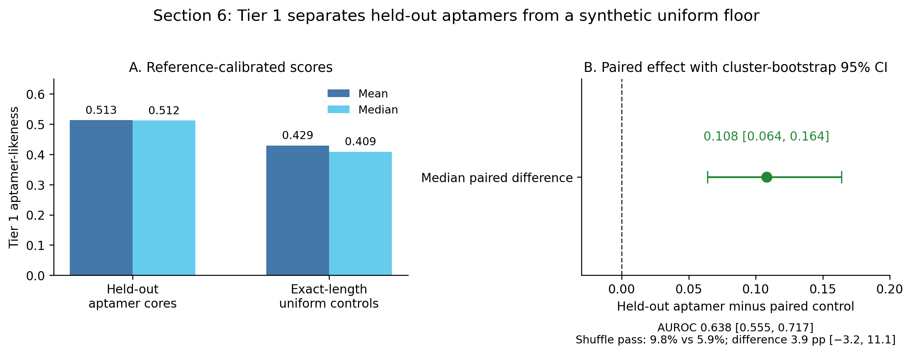
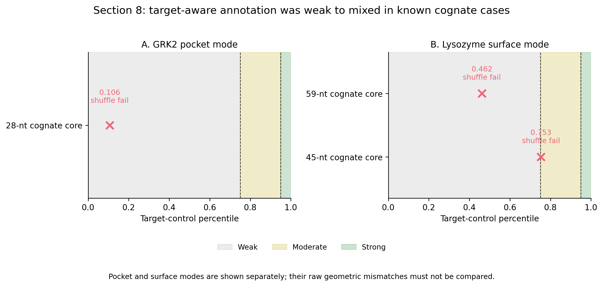
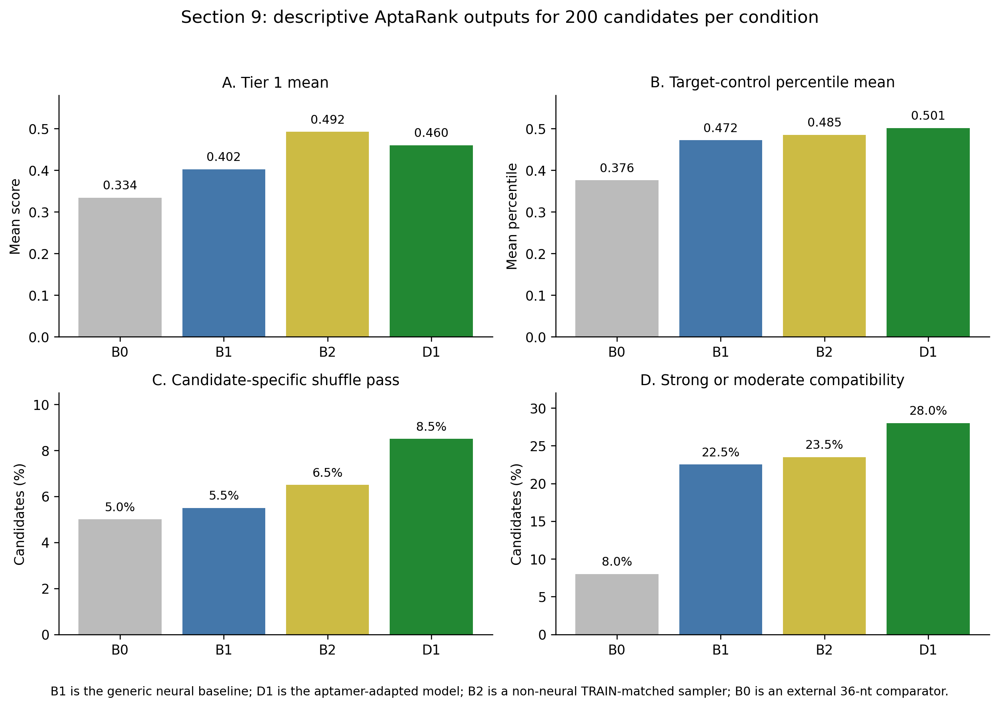
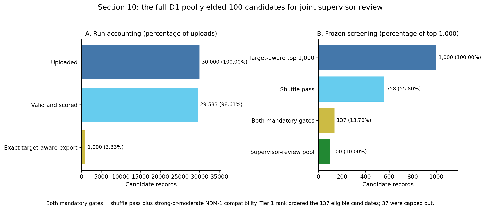

# AptaRank evaluation: supervisor tables and figures

This pack contains the exact aggregate values supporting the [supervisor briefing](aptarank_evaluation_report_supervisor.md). It is sequence-free. All values come from independently reviewed, closed Sections 6–10 result records; no AptaRank score was recomputed for this document.

## Table 1. Evaluation map and denominators

| Stage | Input | Scored or evaluable | Main comparison or filter | Technical exclusions |
|---|---:|---:|---|---:|
| Tier 1 calibration | 308 candidates: 154 EVAL cores + 154 paired controls | 306 candidates; 153 complete pairs; all 79 clusters represented | EVAL core versus its exact-length uniform control | 2 rows forming one 121-nt pair |
| GRK2 target illustration | 1 cognate core | 1 | Descriptive pocket-mode annotation | 0 |
| Lysozyme target illustration | 2 cognate cores | 2 | Descriptive surface-mode annotations | 0 |
| Four-condition NDM-1 comparison | 800 memberships; 200 per condition | 800 | B1 versus D1 primary; B2 secondary; B0 external | 0 |
| Full D1 NDM-1 prioritisation | 30,000 unique D1 sequences | 29,583 | Historical frozen gates and Tier 1 ordering; later v3.10 Tier-1-only final disposition reported separately | 417: 11 below 20 nt, 406 above 100 nt |

## Table 2. Frozen AptaRank production configuration

| Item | Value |
|---|---|
| AptaRank | 0.1.0, schema 1.0.0, Git revision `49a85609e352` |
| Preset | Evaluation |
| Seed | 42 |
| Candidate-specific shuffles | 99, dinucleotide preserving |
| Sampled structures | 200 |
| Tier 1 composite | Five equally weighted REF-anchored criteria; method `corpus_weighted_mean` |
| REF upload | 113 unique curated cores; 113 accepted, 0 dropped |
| Target-control bank | 5,085 REF-derived shuffled controls; no exposed bank identifier or content hash |
| Target-enabled scoring signature | `95a49467ef3c6186` |
| NDM-1 target | PDB 5ZGX, chain A, pocket/groove mode |
| NDM-1 residues | 120, 122, 124, 189, 208, 250 |
| Prepared-target identifier | `0fde4d5e4370` |
| Compatibility bands | weak < 0.75; moderate ≥ 0.75 and < 0.95; strong ≥ 0.95 |

The final Section 10 ordering amendment was adopted after Sections 8 and provisional Section 9 were observed, but before the full D1 pool was run. It pooled strong and moderate as one eligibility class and retained Tier 1 as the ordering signal. This was prospective for Section 10 candidate outcomes but was not prespecified from the beginning of the broader evaluation.

## Table 3. Section 6 Tier 1 distributions

| Group | n | Mean | Median | Q1 | Q3 | IQR | Shuffle pass |
|---|---:|---:|---:|---:|---:|---:|---:|
| Held-out EVAL core | 153 | 0.513 | 0.512 | 0.395 | 0.641 | 0.246 | 15/153 (9.8%) |
| Paired exact-length uniform control | 153 | 0.429 | 0.409 | 0.301 | 0.563 | 0.262 | 9/153 (5.9%) |

## Table 4. Section 6 paired effects and uncertainty

| Estimand | Result | Cluster-bootstrap 95% CI |
|---|---:|---:|
| Median paired difference, EVAL minus control | 0.108 | 0.064 to 0.164 |
| Mean paired difference, EVAL minus control | 0.083 | Not the reported bootstrap target |
| Tie-aware descriptive AUROC | 0.638 | 0.555 to 0.717 |
| Paired shuffle-pass difference | 3.9 percentage points | −3.2 to 11.1 points |

Secondary Wilcoxon signed-rank: W+ = 7,959; two-sided p = 0.000164702. Ten thousand cluster-bootstrap replicates were defined for every reported bootstrap target, with no undefined or imputed replicate.

**Figure 1.** Mean and median Tier 1 values plus the paired median effect. The AUROC and shuffle-pass contrast are shown as supporting annotations. Source: closed Section 6 Evaluation-preset analysis.

## Table 5. Section 8 exact cognate-case outputs

| Target and mode | Core | Length | Tier 1 | Target-control percentile | Band | Geometric mismatch | Shuffle |
|---|---|---:|---:|---:|---|---:|---|
| GRK2 / 3UZS, pocket | Cognate core | 28 | 0.342 | 0.106 | weak | 5.678 | fail |
| Lysozyme / 4M4O, surface | Cognate core, rank 1 | 59 | 0.673 | 0.462 | weak | 1118.838 | fail |
| Lysozyme / 4M4O, surface | Cognate core, rank 2 | 45 | 0.589 | 0.753 | moderate | 374.709 | fail |

The mismatch values are expressed in mode-specific units and must not be compared between pocket and surface modes. The two targets represent two clusters in total, so no confidence interval, correlation or target-discrimination statistic is justified.

**Figure 2.** Exact target-control percentiles with the displayed weak/moderate/strong thresholds. The panels are descriptive and non-comparative across binding modes.

## Table 6. Section 9 Tier 1 and categorical outputs

| Condition | n | Tier 1 mean | Tier 1 median | Tier 1 IQR | Shuffle pass | Strong | Moderate | Weak | Strong or moderate |
|---|---:|---:|---:|---|---:|---:|---:|---:|---:|
| B0 | 200 | 0.334 | 0.304 | 0.205–0.433 | 10/200 (5.0%) | 4 | 12 | 184 | 16/200 (8.0%) |
| B1 | 200 | 0.402 | 0.389 | 0.279–0.520 | 11/200 (5.5%) | 11 | 34 | 155 | 45/200 (22.5%) |
| B2 | 200 | 0.492 | 0.483 | 0.362–0.636 | 13/200 (6.5%) | 9 | 38 | 153 | 47/200 (23.5%) |
| D1 | 200 | 0.460 | 0.445 | 0.338–0.592 | 17/200 (8.5%) | 10 | 46 | 144 | 56/200 (28.0%) |

## Table 7. Section 9 exact NDM-1 target-control percentiles

| Condition | n | Mean | Median | IQR | Strong | Moderate | Weak |
|---|---:|---:|---:|---|---:|---:|---:|
| B0 | 200 | 0.376 | 0.407 | 0.218–0.569 | 4 (2.0%) | 12 (6.0%) | 184 (92.0%) |
| B1 | 200 | 0.472 | 0.407 | 0.250–0.712 | 11 (5.5%) | 34 (17.0%) | 155 (77.5%) |
| B2 | 200 | 0.485 | 0.569 | 0.250–0.712 | 9 (4.5%) | 38 (19.0%) | 153 (76.5%) |
| D1 | 200 | 0.501 | 0.569 | 0.250–0.803 | 10 (5.0%) | 46 (23.0%) | 144 (72.0%) |

## Table 8. Section 9 prespecified contrasts

| Contrast | Tier 1 mean | Tier 1 median | Shuffle pass | Mean target percentile | Median target percentile | Strong rate | Moderate rate |
|---|---:|---:|---:|---:|---:|---:|---:|
| D1 minus B1 | +0.058 | +0.056 | +3.0 pp | +0.029 | +0.162 | −0.5 pp | +6.0 pp |
| D1 minus B2 | −0.033 | −0.038 | +2.0 pp | +0.016 | 0.000 | +0.5 pp | +4.0 pp |

These are descriptive contrasts for frozen candidate samples. They are not confidence-qualified training-population effects because D1 has only two training seeds and candidate rows are not independent training replicates.

## Table 9. Section 9 B1 block and D1 seed summaries

| Stratum | n | Tier 1 mean | Tier 1 median | Shuffle pass | Mean target percentile | Median target percentile | Strong | Moderate | Weak |
|---|---:|---:|---:|---:|---:|---:|---:|---:|---:|
| B1 block A | 100 | 0.416 | 0.416 | 7% | 0.461 | 0.488 | 3 | 17 | 80 |
| B1 block B | 100 | 0.388 | 0.351 | 4% | 0.482 | 0.407 | 8 | 17 | 75 |
| D1 seed 43 | 100 | 0.454 | 0.444 | 6% | 0.488 | 0.569 | 3 | 27 | 70 |
| D1 seed 44 | 100 | 0.465 | 0.453 | 11% | 0.513 | 0.569 | 7 | 19 | 74 |

Tier 1 versus target-control percentile: Spearman rho = −0.0718836, PDF p = 0.0421, n = 800. The magnitude is negligible; the p-value is not interpreted as evidence of biological dependence or independence.

**Figure 3.** Tier 1 mean, mean target percentile, shuffle-pass rate and favourable-band rate for the four 200-candidate samples.

## Table 10. Section 10 complete funnel

| Stage | Records | Pass rate from previous stage | Retained from 30,000 uploads |
|---|---:|---:|---:|
| Uploaded D1 sequences | 30,000 | — | 100.0000% |
| Valid scored records | 29,583 | 98.6100% | 98.6100% |
| Exact target-aware top-1,000 export | 1,000 | 3.3803% | 3.3333% |
| Top-1,000 shuffle pass | 558 | 55.8000% | 1.8600% |
| Shuffle pass and strong-or-moderate compatibility | 137 | 24.5520% | 0.4567% |
| Tier 1 ordered eligible set | 137 | 100.0000% | 0.4567% |
| Supervisor-review pool after cap | 100 | 72.9927% | 0.3333% |

The exact top-1,000 export is an annotation scope rather than a biological pass stage. Across all 29,583 scored candidates, 1,486 (5.0232%) passed the candidate-specific shuffle check.

## Table 11. Section 10 top-1,000 and review-pool composition

| Quantity | Top 1,000 | Jointly eligible | Retained 100 | Capped out 37 |
|---|---:|---:|---:|---:|
| Strong | 69 | 43 | 33 | 10 |
| Moderate | 167 | 94 | 67 | 27 |
| Weak | 764 | 0 | 0 | 0 |
| Seed 43 | Not used as a gate | 76 | 58 | 18 |
| Seed 44 | Not used as a gate | 61 | 42 | 19 |

Retained lengths span 32–96 nt across 46 distinct lengths. Retained Tier 1 ranks span 2–616; the first capped-out eligible rank is 619. The cut is not an exact Tier 1 tie.

## Table 12. Section 10 Tier 1 summaries

| Population | n | Mean | Median | IQR |
|---|---:|---:|---:|---:|
| All scored | 29,583 | 0.436 | 0.423 | 0.310–0.558 |
| Exact top 1,000 | 1,000 | 0.793 | 0.782 | 0.763–0.816 |
| Jointly eligible | 137 | 0.804 | 0.796 | 0.770–0.832 |
| Supervisor-review pool | 100 | 0.820 | 0.816 | 0.791–0.841 |

Tier 1 versus target-control percentile in the exact top 1,000: Spearman rho = 0.00785565, PDF p = 0.804. This negligible association was not used in selection.

**Figure 4.** Run accounting and filtering within the exact target-aware top 1,000. Both mandatory gates left 137 candidates; Tier 1 ordering and the cap retained 100.

## Table 13. Final v3.10 future-shortlisting outcome

| Quantity | Result |
|---|---:|
| Valid scored candidates available | 29,583 |
| Previously prepared Tier-1-only sensitivity pool | 100 |
| Retained future-shortlisting candidates | 50 |
| Advanced to experimental validation | 0 |
| Tier 1 rank range | 1–50 |
| Shuffle `pass` / `fail` annotations | 48 / 2 |
| Tier 2 `strong` / `moderate` / `weak` annotations | 3 / 6 / 41 |
| Shuffle-pass and moderate-or-strong annotations | 8 |
| D1 training seed 43 / 44 | 21 / 29 |
| Length range | 25–96 nt |

The v3.10 set is selected and ordered only by Tier 1 rank. Shuffle and Tier 2 are retained as coarse annotations and do not define eligibility. This later, explicitly outcome-aware disposition does not modify the historical Section 10 funnel or closed 100-candidate gate-based pool.

## Table 14. Interpretation boundaries by evidence source

| Evidence | Supports | Does not support |
|---|---|---|
| Section 6 paired calibration | Moderate Tier 1 separation from uniform RNA | Universal aptamer classification; discrimination from experimental non-binders; binding |
| Section 6 shuffle check | Conservative sequence-order-sensitive screen | Sensitive aptamer detection; treating failure as evidence of non-binding |
| Section 8 cognate cases | Identification of limitations and target-specific warnings | Reliable known-binder recognition; target discrimination; cross-mode ranking |
| Section 9 condition comparison | Descriptive differences in the frozen samples | Population-level training effect; independent biological validation |
| Section 10 review pool | Transparent reduction from 30,000 to 100 candidates | Binder prediction; laboratory success; automatic final candidate selection |
| v3.10 future-shortlisting set | Reproducible Tier-1-led future-work hand-off | Experimental selection; NDM-1 binding; permission to begin laboratory validation |

## Table 15. Closed result records

| Result | Status | Record | Record SHA-256 |
|---|---|---|---|
| Section 6 Evaluation-preset calibration | Closed | `results/aptarank/evaluation/section6_tier1_eval_evaluation_preset_v2/closure/section6_rigorous_closure_record.json` | `ff0cfe59842c4ed63fb8619cf3957b16a29d710246dd19321e7dc1e0af281438` |
| Section 8 target illustration | Closed | `results/aptarank/evaluation/section8_two_target_panel_evaluation_preset_v1/closure/section8_closure_record.json` | `7de67471948c0630595342879c5da4fd091442271cf462321fc624eb139b5da8` |
| Section 8 exact-score supplement | Closed | `results/aptarank/evaluation/section8_two_target_panel_evaluation_preset_v1/supplemental_exact_tier2_v1/closure/section8_exact_tier2_supplement_closure_record.json` | `fbe9e4a09b5726f6f936dc5d8d78bd64a4f7d1ab98fa634dcb386e685d66b936` |
| Section 9 generated-condition comparison | Closed | `results/aptarank/evaluation/section9_generated_conditions_ndm1_evaluation_preset_v1/closure/section9_exact_tier2_closure_record.json` | `92e0b07324cfe0da598147b10ad11a1674fe09cac2036283a7f669681bc86d22` |
| Section 10 computational review pool | Closed | `results/aptarank/evaluation/section10_d1_full_pool_ndm1_evaluation_preset_v1/closure/section10_computational_pool_closure_record.json` | `305367b52eee1cfa56892200db053f67c5652bdb1832ff342b957a16fe1040ee` |
| Final future-shortlisting disposition | Committed | `results/aptarank/evaluation/future_shortlisting_sequences/future_shortlisting_decision_record.json` | `02da670c3c2fd80f4e7efa1b9e093324bca30ea75b8adb0fb0409ebfc47d4d39` |

## Figure files

| Figure | PNG | Scalable SVG |
|---|---|---|
| Section 6 Tier 1 calibration | [PNG](assets/figures/figure_1_section6_tier1_calibration.png) | [SVG](assets/figures/figure_1_section6_tier1_calibration.svg) |
| Section 8 cognate target cases | [PNG](assets/figures/figure_2_section8_cognate_target_cases.png) | [SVG](assets/figures/figure_2_section8_cognate_target_cases.svg) |
| Section 9 generated-condition comparison | [PNG](assets/figures/figure_3_section9_generated_condition_comparison.png) | [SVG](assets/figures/figure_3_section9_generated_condition_comparison.svg) |
| Section 10 shortlisting funnel | [PNG](assets/figures/figure_4_section10_shortlisting_funnel.png) | [SVG](assets/figures/figure_4_section10_shortlisting_funnel.svg) |

The figures were generated by `scripts/modelling/aptarank_supervisor_report_figures.py` from the aggregate values reproduced in this pack. They do not load candidate rows or sequences.
