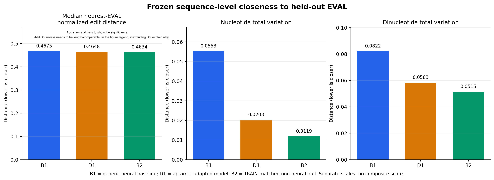
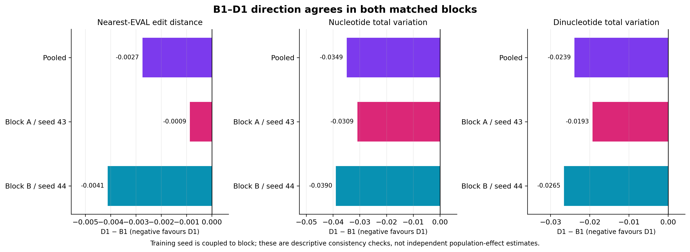
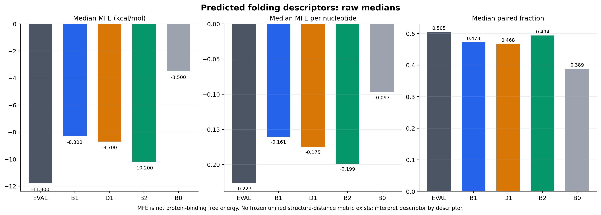
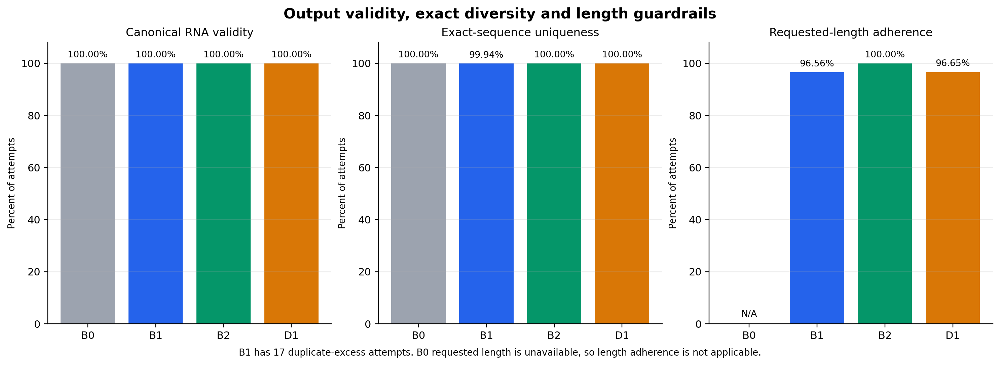

# Supervisor briefing: RNAGenesis generator evaluation closure

**Status: M10 generator-level evaluation complete and reviewed — 19 October 2026.**
The frozen four-condition evaluation ran once successfully against held-out EVAL,
passed independent review, and closed at commit
`9a843c9d7ef8b0c4cdcbb37e9c8bbb0f6a68c79b`. The branch and Mac checkout are
both `generator-eval-prep`. AptaRank was not part of M10 and remains a later
evaluation stage.

- Governing M10 plan: `docs/aptarank_full_mres_thesis_evaluation_plan_v3_4.md`, SHA-256 `1f3a73bc294a75c527e11f074c6d3265786c8e7e70d41eacf3ea83d3cf512941`.
- Active successor plan: `docs/aptarank_full_mres_thesis_evaluation_plan_v3_5.md`, SHA-256 `ebb0e66dd35c7ed20abecacf710ea7a90dd0e2737ba1973af66e8f0753e22c9d`.
- Public sequence-free report: `results/fine_tuning/m10_generator_evaluation/m10_section5_production_v1/m10_sequence_free_report.json`, SHA-256 `20e8daf7b2decb92299a9c0274273fd764db94c63c46e603c204cc7b0f09547f`.
- Detailed reviewed result: [M10 generator evaluation results](m10_generator_evaluation_results.md).
- Supervisor tables: [generator evaluation table pack](generator_evaluation_supervisor_tables.md).

Meeting with Ian + amin notes:

- D1 > B1 but doesn't do well enough compared to B2 null random model. All metrics back this up
- D1 worked as a fine tuned model 
- Other comparisons - B0 - include it or explain why not included 
- Add statistical analysis showing why/why not changes are significant (as footnote or on graph)
- Prioritisation tool - Tier 1 sequence comparisons works a little bit, Tier 2 null result (probably) -> more sophisticated prioritisation approach needed to distinguish FM-generated sequences - eg docking or more target-aware metrics
- Shortlisting - choose 50 from the fine-tuned model -> ask amin 
- Narrative: fine tuning worked in very defined way (align questions in introduction to concrete results), but is not good enough evidence for producing lab-worthy sequences since random did better. More sophisticated generation approaches are needed -> future work. Shows evidence to support improving the generation/prioritisation methods to produce better sequences.
- Results section: order by contribution
- Within contribution order: order in the way that tells the story best. Likely: start by showing the fine-tuning worked, then go into the generator-level comparisons
- Highlight all the shortcomings clearly in the conclusions chapter - explain all the limitations. Then map all the future work steps to the limitations 

## Executive summary

M10 asked whether fine-tuning the generic RNAGenesis diffusion model on the
curated aptamer TRAIN corpus moved its generated sequence distribution toward
held-out experimentally supported aptamers, without exact TRAIN copying or
obvious exact-sequence collapse.

The primary controlled comparison was **B1 versus D1**. D1 was closer to the 154
unique held-out EVAL cores on all three prespecified sequence-level metrics:
nearest-sequence edit distance, nucleotide composition, and dinucleotide
composition. The same direction appeared in both available matched
training-seed/block comparisons. The nearest-sequence change was small; the
composition changes were appreciably larger.

This positive direction requires an important qualification. **B2**, a simple
non-neural sampler matched to low-order TRAIN properties, was numerically closer
to EVAL than D1 on all three metrics and was descriptively closer on the reported
folding summaries. The evaluation therefore supports a shift toward held-out
aptamer characteristics, but it does **not** establish that D1 learned
higher-order aptamer organisation beyond length and low-order composition.

The predicted-structure result was mixed. D1 moved toward EVAL for minimum free
energy (MFE) and MFE per nucleotide, but slightly away for paired fraction. All
four conditions produced 100% valid canonical RNA. D1 produced 30,000 distinct
sequences from 30,000 attempts, whereas B1 had 17 duplicate-excess attempts.
Every condition had zero exact TRAIN overlap.

The defensible conclusion is:

> Aptamer-domain adaptation shifted D1 toward the held-out EVAL distribution
> relative to the matched generic B1 model under all three prespecified
> sequence-level closeness metrics, with the same direction in both available
> training-seed/block comparisons. The stronger B2 result shows that much of
> this measured resemblance can be reproduced by matching simple TRAIN
> properties, so the result is directional evidence rather than proof of
> higher-order aptamer learning.

These are computational distributional results. They do not demonstrate
binding, affinity, specificity, inhibition, therapeutic activity, or
NDM-1-specific generation.

## Scientific question and generator conditions

The four frozen conditions have different scientific roles. They are not four
equivalent model replicates.

| Condition                                | Definition                                                                                                                                                   | Scientific role                                                                                             |
| ---------------------------------------- | ------------------------------------------------------------------------------------------------------------------------------------------------------------ | ----------------------------------------------------------------------------------------------------------- |
| **B1 — generic RNAGenesis baseline**     | The released generic RNA diffusion model, evaluated under the matched MRes generation schedule.                                                              | Primary unadapted neural counterfactual for D1.                                                             |
| **D1 — MRes aptamer-adapted RNAGenesis** | B1 architecture fine-tuned on the 669 unique curated TRAIN aptamer cores. Production combines 15,000 attempts from training seed 43 and 15,000 from seed 44. | Adaptation intervention; compare primarily with matched B1 blocks and retain the two seed-specific results. |
| **B2 — empirical i.i.d. null**           | A non-neural sampler from frozen TRAIN-derived low-order sequence properties, using one empirical-null seed (42).                                            | Tests how much apparent EVAL resemblance can be achieved without a learned sequence model.                  |
| **B0 — released aptamer-adapted model**  | Historical released aptamer-adapted RNAGenesis output. All cleaned outputs are 36 nt under its nominal 37-nt regime.                                         | External descriptive benchmark only; not part of the controlled B1–D1 estimate.                             |

**Aptamer** here means an oligonucleotide selected or experimentally supported
for binding a target. EVAL is a held-out set of such curated aptamer records; it
is not a set of experimentally confirmed non-binders and is not a universal
definition of good RNA.

## Frozen evaluation design

### Held-out reference and analysis grains

The frozen EVAL file matched SHA-256
`ff4b36535052981c240dfa0571acd9cf00a386c80d9487a5994d1597f3386015`.
It contained **181 scientific identities / 154 unique sequence cores / 79
related-sequence clusters**. The 154 unique cores, comprising 89 short-regime and
65 long-regime cores, were each weighted once in the EVAL formulas. The 79
clusters are a design fact and a limitation; they did not weight the M10 metrics.

Generated metrics used valid attempt rows and retained repeated attempts. This
keeps the generator's observed output distribution intact. A distinct-sequence
count was reported separately as a diversity guardrail. No invalid, duplicate,
or unfavourable output was replenished or silently replaced.

The main denominators were:

| Condition | Attempts | Valid RNA | Unique valid | Invalid | Duplicate excess |
| --------- | -------- | --------- | ------------ | ------- | ---------------- |
| B0        | 30,080   | 30,080    | 30,080       | 0       | 0                |
| B1        | 30,000   | 30,000    | 29,983       | 0       | 17               |
| B2        | 30,000   | 30,000    | 30,000       | 0       | 0                |
| D1        | 30,000   | 30,000    | 30,000       | 0       | 0                |

### Prespecified sequence metrics

No aggregate generator-quality score was formed. Each metric answers a different
question and remains separate.

| Metric                                | Calculation and interpretation                                                                                                                                                                       | Direction        |
| ------------------------------------- | ---------------------------------------------------------------------------------------------------------------------------------------------------------------------------------------------------- | ---------------- |
| Nearest-EVAL normalized edit distance | For each valid generated row, the minimum Levenshtein edit distance to any unique EVAL core, divided by the length of the longer sequence; the headline value is the median over generated attempts. | Lower is closer. |
| Nucleotide total variation (TV)       | Half the L1 distance between pooled A/C/G/U fractions in the generated condition and the 154 EVAL cores.                                                                                             | Lower is closer. |
| Dinucleotide total variation (TV)     | Half the L1 distance between pooled fractions of the 16 overlapping dinucleotides in the generated condition and EVAL.                                                                               | Lower is closer. |

Levenshtein distance counts the minimum insertions, deletions, and substitutions
needed to transform one sequence into another. Total variation ranges from 0 for
identical pooled distributions to 1 for non-overlapping distributions. Neither
quantity measures binding or biological function.

Length strata used the frozen two-component S6 assignment rule, not a newly
chosen fixed cutoff. The mixture was not refitted after EVAL was seen.

### Predicted folding descriptors

Each distinct valid sequence was folded once using `RNA.fold(sequence)` in
ViennaRNA 2.7.0; attempt-level summaries retained duplicate-attempt weighting.
Each of the 154 unique EVAL cores was folded once. The retained descriptors were:

- **MFE:** predicted minimum free energy in kcal/mol;
- **MFE per nucleotide:** MFE divided by sequence length;
- **paired fraction:** fraction of nucleotides paired in the predicted minimum-energy structure.

These are descriptive computational predictions. More negative MFE is not
automatically better, and M10 prespecified no unified structure-distance metric.

### Seed and block design

B1 and D1 were generated in two matched technical blocks:

- block A: 15,000 B1 attempts matched to 15,000 D1 attempts from training seed 43;
- block B: 15,000 B1 attempts matched to 15,000 D1 attempts from training seed 44.

The requested-length schedules were matched one-to-one. Training seed is coupled
to block and generation-seed range, so these two comparisons show directional
consistency but cannot cleanly separate a training-seed effect from a block
effect. The 30,000 sequence rows are Monte Carlo outputs, not 30,000 independent
model-training replicates. Observed two-seed ranges are not confidence intervals.

M10 deliberately reported no bootstrap, hypothesis test, generator confidence
interval, or EVAL-cluster resampling.

## Results

### Primary B1–D1 comparison

All three frozen metrics favoured the equal-seed D1 mixture over B1.

| Lower is closer to EVAL                      | B1       | D1       | D1 − B1   |
| -------------------------------------------- | -------- | -------- | --------- |
| Median nearest-EVAL normalized edit distance | 0.467532 | 0.464789 | −0.002744 |
| Nucleotide TV                                | 0.055273 | 0.020335 | −0.034938 |
| Dinucleotide TV                              | 0.082193 | 0.058307 | −0.023886 |

**Figure 1. Frozen sequence-level closeness to EVAL.** D1 improves on B1 in all
three panels, but B2 is numerically closer than D1. The axes differ by metric;
bar heights must not be compared across panels as if they formed one score.

The nearest-edit improvement is only about 0.0027 on a 0–1 scale. The larger
nucleotide and dinucleotide changes show that adaptation altered low-order
composition more clearly than nearest-sequence similarity.

### Consistency across the two available matched blocks

D1 was closer than its matched B1 block on all three metrics in both comparisons.

| Metric                            | Block A / seed 43 difference | Block B / seed 44 difference |
| --------------------------------- | ---------------------------- | ---------------------------- |
| Median nearest-EVAL edit distance | −0.000866                    | −0.004118                    |
| Nucleotide TV                     | −0.030926                    | −0.038951                    |
| Dinucleotide TV                   | −0.019268                    | −0.026541                    |

**Figure 2. Directional consistency in the B1–D1 comparison.** Negative values
mean D1 is closer to EVAL. Both blocks agree in direction, but the two blocks are
not enough to estimate a population-level training effect precisely.

Length adherence was nearly identical overall: 28,967/30,000 B1 attempts
(96.56%) and 28,995/30,000 D1 attempts (96.65%) exactly matched their requested
length. Length adherence therefore does not explain the main B1–D1 difference.

### B2 limits the higher-order interpretation

B2 was numerically closer than D1 on every frozen sequence metric:

| Metric                            | D1       | B2       |
| --------------------------------- | -------- | -------- |
| Median nearest-EVAL edit distance | 0.464789 | 0.463415 |
| Nucleotide TV                     | 0.020335 | 0.011854 |
| Dinucleotide TV                   | 0.058307 | 0.051472 |

Because B2 is not a trained generative model, this ordering indicates that the
headline EVAL metrics are substantially sensitive to properties that a simple
TRAIN-matched sampler can reproduce. This does not erase the controlled D1–B1
shift; it limits the claim that can be attached to that shift.

### Predicted structure is mixed

| Median descriptor  | EVAL    | B1      | D1      | B2      | B0      |
| ------------------ | ------- | ------- | ------- | ------- | ------- |
| MFE (kcal/mol)     | −11.80  | −8.30   | −8.70   | −10.20  | −3.50   |
| MFE per nucleotide | −0.2268 | −0.1605 | −0.1750 | −0.1987 | −0.0972 |
| Paired fraction    | 0.5053  | 0.4727  | 0.4675  | 0.4938  | 0.3889  |

**Figure 3. Predicted folding descriptors.** D1 shifts toward EVAL for MFE and
MFE per nucleotide but slightly away for paired fraction. B2 lies closer to EVAL
on all three descriptors. These are raw medians, not a frozen structure-distance
score.

### Validity, exact diversity, TRAIN novelty, and length guardrails

All four conditions achieved 100% canonical A/C/G/U validity. D1, B2, and B0 had
no exact duplicates; B1 had 17 duplicate-excess attempts and a unique fraction of
0.99943. Exact uniqueness provides no evidence of D1 exact-sequence collapse,
but it cannot exclude near-duplicate or cluster-level narrowing.

Every condition had zero exact TRAIN overlap. Median nearest-TRAIN normalized
edit distance was 0.4444 for B1 and 0.4400 for D1. D1 therefore moved slightly
closer to TRAIN as well as to EVAL, without copying TRAIN exactly. B2 was 0.4412;
the separate B0 value was 0.4167.

**Figure 4. Output guardrails.** Validity is 100% in all conditions. Exact
uniqueness is 100% except for the small B1 duplicate excess. B1 and D1 have
nearly identical requested-length adherence; B2 is exactly length matched. B0 has
no recorded biological requested length, so its length-adherence value is not
applicable.

### B0 remains an external descriptive panel

B0 had the numerically lowest nearest-EVAL median (0.4510), but nucleotide TV
(0.3221), dinucleotide TV (0.4494), and all three folding descriptors were much
farther from EVAL. Its fixed 36-nt cleaned output, historical generation regime,
and unresolved independence of external training publications make it unsuitable
for the matched B1–D1 causal interpretation. Its apparently favourable edit
distance should not be isolated from these strong discordances.

## What the evaluation supports

- D1 shifted toward EVAL relative to matched B1 under all three frozen
sequence-level metrics.
- The direction was consistent in the two available seed/block comparisons.
- The clearest changes were in low-order mono- and dinucleotide composition.
- D1 retained 100% canonical validity and showed no exact duplicate collapse.
- No condition exactly reproduced a TRAIN sequence.

## What the evaluation does not establish

- It does not show that D1 generates binders, high-affinity aptamers, selective
aptamers, inhibitors, or NDM-1-specific candidates.
- It does not show a population-level model effect with quantified uncertainty;
only two coupled D1 seed/block comparisons were available.
- It does not establish higher-order aptamer organisation beyond simple length
and composition properties, because B2 performed at least as well on the
frozen descriptors.
- It does not exclude near-duplicate or cluster-level mode narrowing; generated
sequence/structure clustering was deliberately deferred.
- It does not make B0 part of the controlled comparison.
- It does not combine the metrics into a single score or hide their mixed
structural direction.

## Execution, validation, and provenance

The production pathway failed closed twice before the successful run. The first
invocation found the expected EVAL path absent before any bytes were read. The
next verified the frozen EVAL hash but rejected repeated `sequence_id` values.
Frozen corpus documentation showed that `sequence_id` identifies a sequence core
and may legitimately repeat across distinct aptamer–target identities;
`scientific_identity_id` is the unique row key. The corrected adapter retained
all 181 identities and collapsed them to the expected 154 unique cores. No
metric, threshold, generator pool, or biological input changed.

The corrected authorized run completed in 3,310.94 seconds, read EVAL once,
reported a `distinct_fold_count` of 120,216 across generated/reference inputs,
and published atomically.
The final synthetic generator-evaluation suite passed 206 tests without loading
repository EVAL data. Raw sequence-bearing evidence remains protected and is not
required to read this report.

| Frozen item                | Identifier or SHA-256                                              |
| -------------------------- | ------------------------------------------------------------------ |
| M10 closure Git commit     | `9a843c9d7ef8b0c4cdcbb37e9c8bbb0f6a68c79b`                         |
| Metric specification       | `2b0679b999235cc838298563448b01ef73f5fdd5132c5ddd3d9944f301f5c824` |
| Production runner          | `02735f84f264b3b0cfe7f9b5d2ab704846bb5840f9235707197e2999f9152c77` |
| EVAL input                 | `ff4b36535052981c240dfa0571acd9cf00a386c80d9487a5994d1597f3386015` |
| Sequence-free report       | `20e8daf7b2decb92299a9c0274273fd764db94c63c46e603c204cc7b0f09547f` |
| Run manifest               | `5d828d918ff8d79e66d65181584175c87d125f69f59b76b2e3a48e78395803d0` |
| Protected derived evidence | `9ba39df6e9c24196d35958613f373f92bac6bf720acde6a07e3880d9d6dc42ee` |

The protected derived file is retained outside Git at mode `0600`. Its digest was
verified by byte hash; it was not opened to prepare this supervisor report.

## Short glossary

- **Attempt:** one requested generator output. Attempt counts retain invalid and
repeated outputs; no attempt is replaced after evaluation.
- **Sequence core:** the canonical A/C/G/U aptamer sequence used for comparison,
without construct context such as optional flanks.
- **Scientific identity:** one curated sequence-core/canonical-target
relationship. More than one identity may share the same sequence core.
- **TRAIN / VALIDATION / REF / EVAL:** frozen data roles. TRAIN fits D1;
VALIDATION supported model decisions; REF calibrates the later AptaRank
workflow; EVAL is the final held-out set.
- **Training seed:** random initialization for an independent D1 fine-tuning run.
Seeds 43 and 44 produced the two retained D1 checkpoints.
- **Generation seed:** randomness used to sample sequences from a fixed model;
it is not an independent model-training replicate.
- **Technical block:** a matched generation schedule. Block A couples B1 with D1
seed 43; block B couples B1 with D1 seed 44.
- **Empirical i.i.d. null (B2):** independent nucleotide sampling from frozen
TRAIN-derived empirical properties, without a learned sequence model.
- **Duplicate excess:** valid attempt count minus distinct valid-sequence count.
- **MFE:** predicted minimum free energy of an RNA secondary structure; it is not
binding free energy to a protein.
- **Total variation:** half the L1 distance between two categorical
distributions; 0 means identical and 1 means non-overlapping.
- **Directional evidence:** consistent observed movement under the prespecified
metrics, without a confidence-qualified population effect.

## Remaining evaluation work

M10 is closed. Sections 6–10 of evaluation plan v3.5 remain required and begin
with REF-calibrated AptaRank Tier 1 EVAL. They include the illustrative Tier 2
EVAL analysis, generated-candidate Tier 1 and Tier 2, the NDM-1 review table, and
the final candidate decision record. Those later computational scores are
prioritisation evidence, not experimental binding validation.

## Figure and table files

The four presentation-ready figures are stored under
`docs/fine_tuning/generator_evaluation_supervisor_assets/figures/`. Their plotted
values are reproduced in the separate [supervisor table pack](generator_evaluation_supervisor_tables.md).
All values come from the frozen sequence-free report and reviewed M10 result note;
no protected row-level evidence was opened or recalculated.

## Report-update boundary

This documentation stage creates this supervisor briefing, its table pack, and
four aggregate figures only. It does not rerun generation, parsing, folding,
distance calculations, EVAL access, or AptaRank. It does not alter the frozen
metric specification, M10 outputs, governing plans, scientific interpretation,
or protected evidence.
